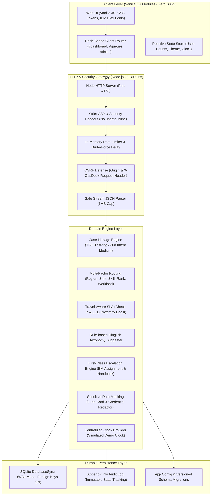
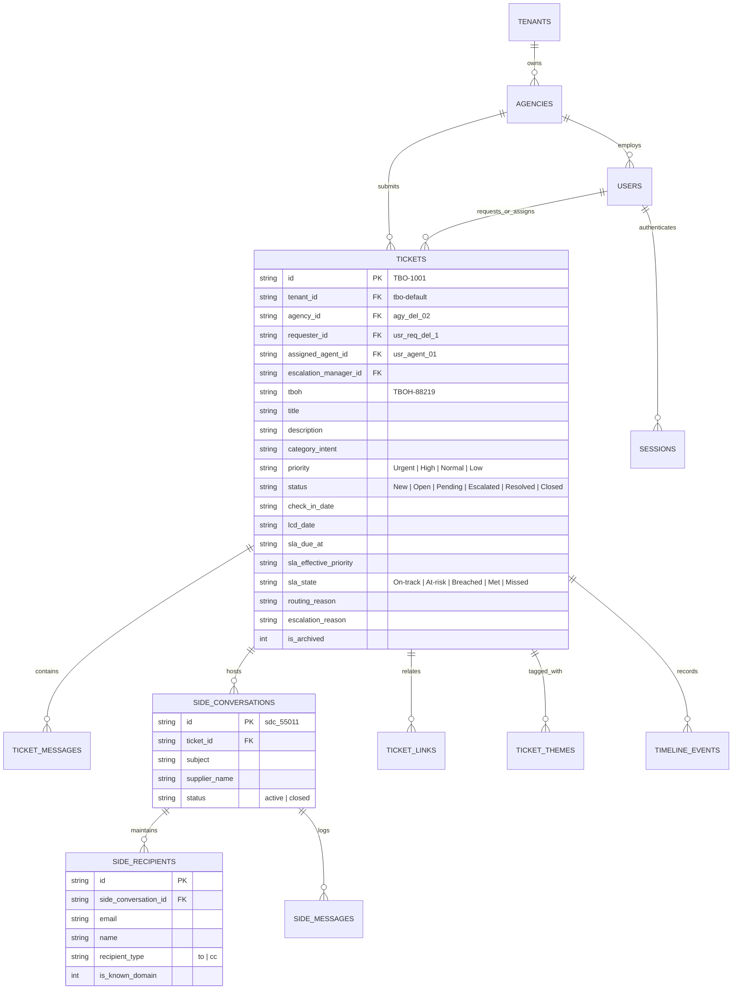
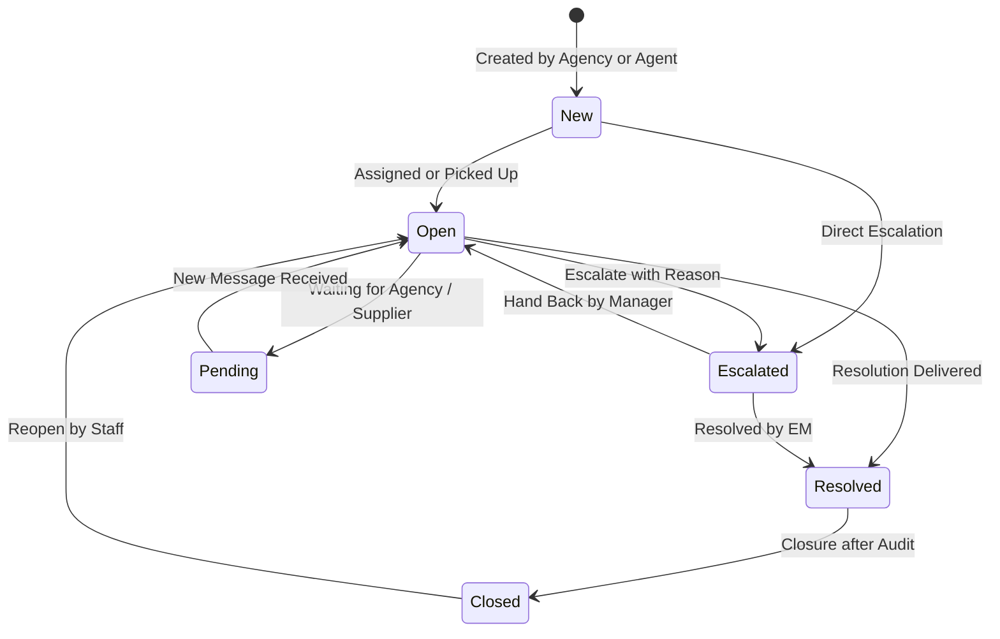

# OpsDesk - Architecture & Technical Design

OpsDesk is an operations ticketing platform custom-engineered for TBO's B2B travel operations. It replaces disconnected, reactive ticketing with context-rich, travel-aware cases linked by agency and booking reference (TBOH), routed by operational reality, and escalated intentionally.

---

## 1. System Architecture Diagram

---

## 2. Data Model & Entity Relationships

---

## 3. Case Lifecycle State Machine

OpsDesk enforces strict allowed transitions on the server. Invalid transitions return an HTTP 400 with allowed next states.

---

## 4. Multi-Factor Routing Formula

Eligibility is gated strictly on `is_available = 1`. Qualifying agents are scored by:

$$\text{Score} = \text{RegionMatch}(+40) + \text{ShiftWindow}(+20) + \text{SkillMatch}(+15) + \text{RankScore} - (5 \times \text{OpenTickets})$$

Where:
- $\text{RankScore}_{\text{Urgent/High}} = 8 \times \text{Rank}$ (Favoring senior agents for crises)
- $\text{RankScore}_{\text{Normal/Low}} = 4 \times (4 - \text{Rank})$ (Distributing routine cases to junior agents)

If all available agents score $\le 0$ or no agent is on shift, the case automatically defaults to **Triage (Unassigned)** with an auditable explanation.

---

## 5. Travel-Aware SLA Engine

Unlike static ticketing clocks, OpsDesk boosts resolution urgency based on real-world travel proximity:
- If $\min(\text{Check-in}, \text{LCD}) \le \text{Now} + 12\text{ hours}$: Priority boosted to **Urgent** ($2\text{h}$ base window).
- If $\min(\text{Check-in}, \text{LCD}) \le \text{Now} + 48\text{ hours}$: Priority boosted to at least **High** ($8\text{h}$ base window).
- Dynamic deadline:

$$\text{Due Date} = \max(\text{Created} + 30\text{ min}, \min(\text{Created} + \text{BaseHours}, \text{TravelEvent} - 2\text{ hours}))$$

- **At-risk**: Triggers when remaining time $\le 30\%$ of total window OR $\le 1\text{ hour}$.
- **Breached**: Triggers when $\text{Now} \ge \text{Due Date}$.
